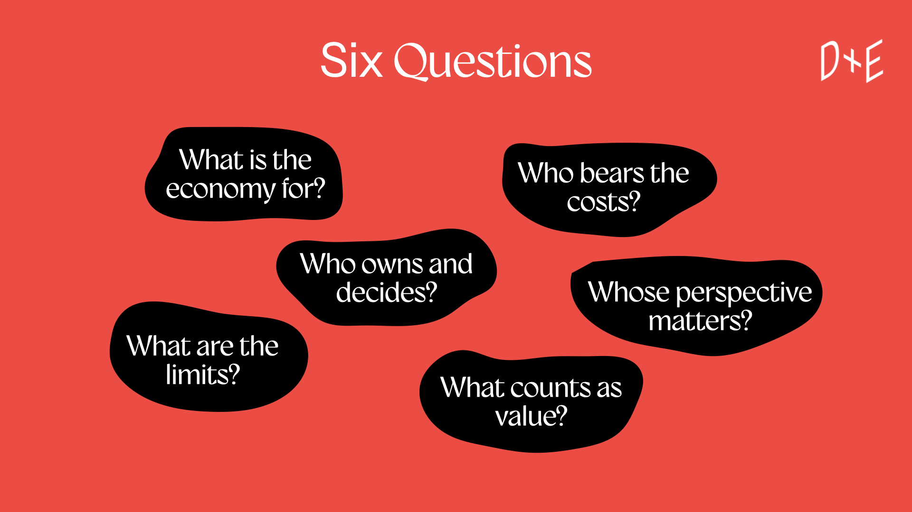
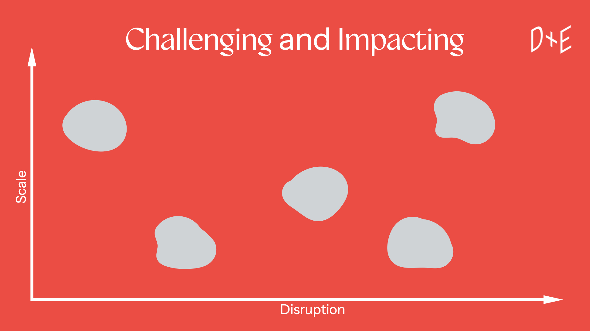

We're currently developing and testing a toolkit which will be available as a download and a physical artefact.

<ul>
<li>
Join the mailing list and we'll let you know when the toolkit is available.
</li>
<li><h2>Modelling</h2>
Explore alternative economic models and identify actions to take in response.
</li>
<li><h2>Scoping</h2>
Explore how actions might work individually or collectively and how disruptive they might be.

</li>
</ul>

