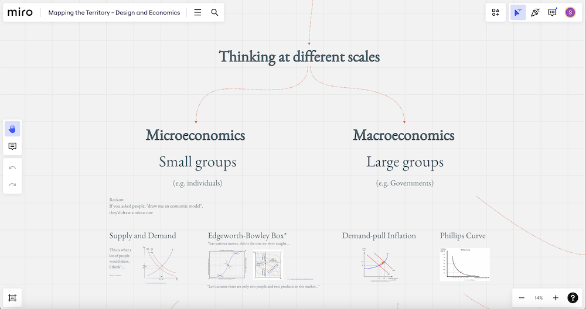
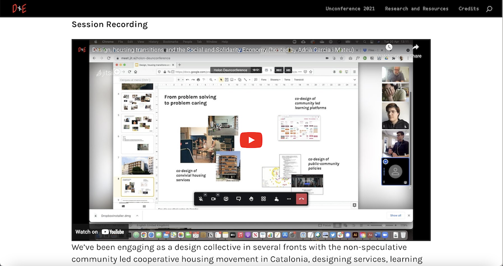

We're currently developing and testing a toolkit which will be available as a download and a physical artefact.

<ul>
<li>
Join the mailing list and we'll let you know when the toolkit is available.
</li>
<li><h2>Resources</h2>
We're capturing our events, curating materials from our community and sharing them on <a href='https://designandeconomics.notion.site/1eb4251ca0394a0db303c8667a734698?v=1100029d91c04a17bb73d8ccbab1e181'>our Notion site</a>. If you have relevant reading, viewing or listening to share just <a href="https://forms.gle/xFxuGD71w7dxzP3i8">send it to us using this form.</a>
</li>
<li><h2>Community</h2>
Join <a href="https://www.linkedin.com/groups/12986178/">the Design and Economics Group on LinkedIn</a> for discussions and resource sharing.

</li>
</ul>

